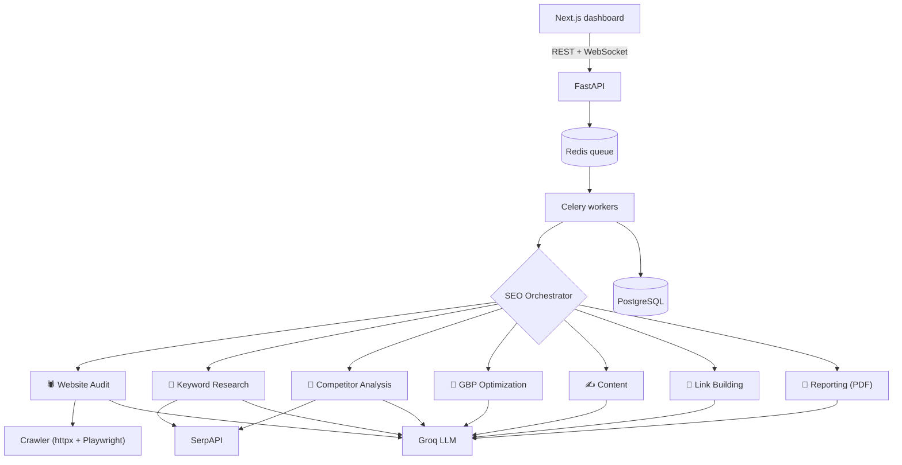

<div align="center">

# 🔎 BRIHA · SEO Automation Bot

**A multi-agent AI system that automates end-to-end SEO for local businesses: audit, keywords, competitors, Google Business Profile, content, links and monthly reports.**


</div>

> ⚡ **Part of [BRIHA](https://github.com/asad110abbas)**, built by Syed Asad Abbas.

---

## Overview

Local businesses (clinics, restaurants, law firms…) need SEO but can't afford an agency. This bot replaces a
whole SEO team with **7 specialized AI agents** coordinated by an orchestrator. Each agent runs as a background
job, streams live progress to the dashboard over WebSockets, and stores structured results you can act on.

## Architecture



## The 7 agents

| Agent | What it does |
|---|---|
| 🕷️ **Website Audit** | Crawls the site and flags technical SEO issues: titles, meta, headings, broken links, speed signals |
| 🔑 **Keyword Research** | Generates seed keywords with the LLM, enriches them with live SERP data, and ranks opportunities |
| 🥊 **Competitor Analysis** | Finds who ranks for your keywords and what they do better |
| 📍 **GBP Optimization** | Recommendations for the Google Business Profile: categories, description, posts |
| ✍️ **Content** | SEO-optimized page and blog drafts for target keywords |
| 🔗 **Link Building** | Backlink and citation opportunities for local SEO |
| 📄 **Reporting** | Monthly client-ready PDF report (Jinja2 + WeasyPrint) |

## Features
- **Background jobs** with Celery + Redis and live progress over WebSockets
- **Per-run token and cost tracking** with usage dashboards (per project and global)
- **Rate limiting** per project per day, JWT auth, retries with exponential backoff
- **Alembic** migrations, async SQLAlchemy, structured logging
- **Dockerized**: dev and production compose files

## Quick start

```bash
git clone https://github.com/asad110abbas/seo-automation-bot.git
cd seo-automation-bot
cp backend/.env.example backend/.env     # add GROQ_API_KEY, SERPAPI_KEY, SECRET_KEY
docker compose up --build
```
- Dashboard: http://localhost:3000
- API docs: http://localhost:8000/docs

## Tech stack

| Layer | Technologies |
|---|---|
| AI | Groq (Llama 3.3 70B), prompt-engineered agents |
| Backend | Python, FastAPI, SQLAlchemy (async), Alembic, Celery, Redis |
| Data | PostgreSQL, SerpAPI |
| Scraping | httpx, BeautifulSoup, Playwright |
| Reports | Jinja2, WeasyPrint |
| Frontend | Next.js 14, TypeScript, Tailwind CSS, TanStack Query |
| Ops | Docker, Docker Compose |

## License

[MIT](LICENSE)
